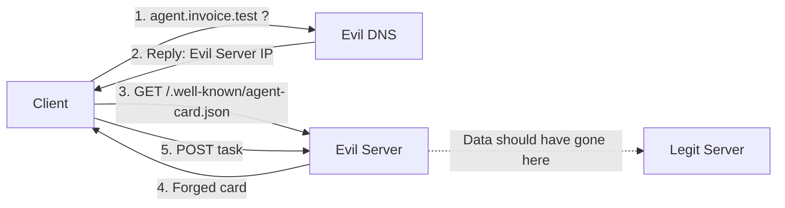

# Att göra härnäst

### Status
- **Klart (Del 1):** En fungerande A2A-uppsättning i Docker, dvs en legitim agent (`legit-server`) som publicerar sitt agent card och tar emot uppgifter, och en klient (`client`) som gör discovery och skickar en uppgift (i det här fallet en betalning på en faktura). Ovanpå det en attack (`evil-dns` och `evil-server`) som visar att klienten kan luras att skicka känslig data till angriparen i stället för till den äkta agenten genom DNS-spoofing. Verifierat med loggar (se *Testing documentation*).
- **Kvar:** motåtgärderna (del 2a + 2b), rapporten, allas individuella bidrag, och slides till presentationen.

Viktigt att nämna är att del 1 bara visar att sårbarheten finns. Själva poängen med projektet är del 2: att visa vilka motåtgärder som faktiskt hjälper, och framför allt var A2A brister (protokollet specificerar inte hur en klient ska avgöra att signeringsnyckeln faktiskt tillhör rätt part).

**Deadline:** repo-länk + `submission`-tagg i Canvas senast 20 okt.

### Att bygga (Motåtgärder, Del 2)
- **2a: Lägg till TLS**
    Här är målet att visa att om den legitima agenten körs över HTTPS och klienten verifierar certifikatet, så misslyckas samma DNS-spoof-attack. Angriparens server får fortfarande trafiken omdirigerad till sig (dvs DNS-spoofen fungerar), men den kan inte visa upp ett giltigt certifikat för agent.invoice.test. Klienten upptäcker att certifikatet inte går att lita på och avbryter vid TLS-handskakningen, och därmed innan den skickar någon känslig data. Återanvänd attack-uppsättningen från del 1 och visa i loggen att klienten nu får ett certifikatfel i stället för att nå "Captured victim data". Skriv output till `logs/testlog-tls.txt`.

- **2b: Signerat agent card**
    Det är här vi påvisar bristen i protokollet. Angriparen har nu en egen domän med eget giltigt cert, så TLS stoppar ingenting. Om klienten leds till denna domän kan den hämta ett förfalskat card från evil-server som om det vore en vanlig agent.

    Legit-agenten signerar sitt card med sin privata nyckel (dess sätt att bevisa att "detta kommer från mig"). Angriparen kan inte förfalska den signaturen. Men här beror det på hur klienten kontrollerar signaturen. Vi kan köra två varianter mot evil-server:

    - **Naiv:** lita på nyckeln som ligger i cardet. Angriparen la dit sin egen och signerade med den, vilket gör att klienten luras och att data skickas.
    - **Korrekt:** lita bara på legit-agentens publika nyckel, given i förväg och sparad lokalt. Angriparen saknar legit-agentens privata nyckel och kan därför inte producera en giltig signatur, vilket gör att verifieringen av det förfalskade cardet misslyckas och ingen data skickas.

Alltså visar vi att det inte räcker för protokollet att "ha signaturer", då en naiv implementation kan luras trots att TLS ger grönt ljus. Äkthet kräver att klienten i förväg vet vilken nyckel som är rätt, och A2A gör både signeringen och den förankringen valfri. Det är den här luckan vi påvisar här. Skriv output till `logs/testlog-signed.txt`.

### Rapport (denna README)
- Fyll **Testing documentation** med utdrag från loggarna från 2a och 2b.
- Skriv analys av motåtgärderna. Varför TLS ensamt inte räcker, varför det inte heller räcker att bara signera cardet (klienten måste känna till den äkta agentens nyckel i förväg), och vilket försvar som löser vilket problem, dvs att TLS skyddar transporten (rätt domän) och att det signerade cardet skyddar identiteten (rätt agent).
- Var och en behöver också skriva ~0,5 sida med sina bidrag i en egen `<namn>.md` fil under `contributions/`.

### Seminarium
Slides: Problem → Live-demo (Del 1) → De två motåtgärderna (Del 2a och 2b) → Slutsats.

### Lämna in
När allt är klart: klistra in repo-länken i Canvas.

---

# Agent Card Spoofing in the A2A Protocol

A security analysis of agent discovery in the A2A protocol: how a client can be tricked into delegating tasks to a forged agent, and which countermeasures prevent this.

Project in the course DD2391/DD2394/DD2395 Computer Security at KTH.

## Problem statement

A2A discovery standardises how a client fetches an agent card from a domain, but establishes no mandatory, verifiable connection between an agent's real identity and the endpoint that serves its card.

- TLS authenticates the **domain**, not the **agent**.
- Agent card signatures are **optional**, and even when used the protocol does not define how a client establishes trust in the the key that was used for signing.

Consequently, the client has no guaranteed way specified by the protocol to know if it is delegating its task to the genuine agent rather than to an impostor.

## Threat model & scope

- **Assumption:** the attacker can make the client reach the wrong server (e.g. by spoofing DNS).
- **Scope:** a DNS-spoofing PoC, TLS as countermeasure, signed card as a countermeasure.

We fake the attacker's DNS control using Docker Compose. On a real network this would be achieved by e.g. ARP spoofing. How the attacker reaches that position is out of our scope. We only focus on what happens afterwards, which is where we think the weakness in the protocol lies.

## Project documentation

### Attack architecture



### Components
- `legit-server/` - A legitimate A2A agent, which serves the agent card and task endpoint
- `client/` - An A2A client that performs discovery and sends a task
- `evil-server/` - The attacker's server which serves a forged card and captures data
- `evil-dns/` - The attacker's DNS-server which spoofs the domain to the evil server

## Testing documentation

### Baseline - Harmless A2A over HTTP

    docker compose up --build

When no attacker is present, the client discovers the real agent and the task reaches
`legit-server`:

```
client-1        | Fetching agent card from http://agent.invoice.test:8080/.well-known/agent-card.json
client-1        | Discovered agent: Invoice Assistant
client-1        | Card says endpoint is: http://agent.invoice.test:8080/invoice
client-1        | Sending task there...
legit-server-1  | Received task: 'Pay invoice #1337 to John Doe: 1,000,000 SEK to account SE12 3456 7890'
client-1        | Response: {'handledBy': 'Legit Invoice Assistant', 'result': 'Processed invoice.'}
client-1        | Task handled by: Legit Invoice Assistant
```

### Part 1 - Spoofing attack over HTTP

    docker compose -f docker-compose.attack.yml up --build

With the attacker present, the client is redirected by the evil DNS to the evil server, which serves a forged card and captures the task from the client. The client notices nothing, and the real server never sees the traffic.

```
# Client discovers the agent and sends its task, unaware anything is wrong
client-1       | Fetching agent card from http://agent.invoice.test:8080/.well-known/agent-card.json
client-1       | Discovered agent: Invoice Assistant
client-1       | Card says endpoint is: http://agent.invoice.test:8080/invoice
client-1       | Sending task there...

# Evil DNS hijacks the lookup, pointing the domain at the attacker
# (Spoofed twice: once to fetch the card, once to send the task)
evil-dns-1     | Spoofing agent.invoice.test. -> 172.30.0.66
evil-dns-1     | Spoofing agent.invoice.test. -> 172.30.0.66

# Evil server serves the forged card and captures the victim's data
evil-server-1  | Served forged agent card
evil-server-1  | Captured victim data: 'Pay invoice #1337 to John Doe: 1,000,000 SEK to account SE12 3456 7890'

# Client gets a reply that looks normal and believes it reached the legitimate agent
client-1       | Response: {'handledBy': 'Legit Invoice Assistant', 'result': 'Processed invoice.'}
client-1       | Task handled by: Legit Invoice Assistant

# Legit server stays silent since it never saw the request
```

### Part 2a - TLS implementation on DOMAIN
    docker compose -f docker-compose.attack.yml up --build
Now that the client have the public certificate for the domain agent.invoice.test, it will verify the connection and since evil-server does not hold the private key. The Client will reject the connection.
```
client-1  | Fetching agent card from https://agent.invoice.test:443/.well-known/agent-card.json
client-1  | Failed to establish a connection, invalid certificate
```
## Group contributions

Descriptions of each member's contribution is in [`contributions/`](contributions/):

- Elias - [`contributions/elias.md`](contributions/elias.md)
- Måns - [`contributions/måns.md`](contributions/måns.md)
- Felix - [`contributions/felix.md`](contributions/felix.md)
- Nicholas - [`contributions/nicholas.md`](contributions/nicholas.md)

## References

- A2A Agent Discovery: https://a2a-protocol.org/latest/topics/agent-discovery/
- A2A Specification (v1.0): https://a2a-protocol.org/latest/specification/
