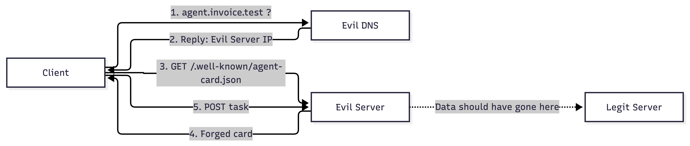

# Agent Card Spoofing in the A2A Protocol

A security analysis of agent discovery in the A2A protocol: how a client can be tricked into delegating tasks to a forged agent, and which countermeasures prevent this.

Project in the course DD2391/DD2394/DD2395 Computer Security at KTH.

## Introduction

Agent-to-agent (A2A) is a protocol that lets AI agents discover
one another and delegate tasks. Before a client can use a remote agent, it fetches
that agent's *agent card* - a small JSON document, served at a standardised
well-known URL, that describes the agent and, crucially, the endpoint tasks should
be sent to.

This project examines a weakness in this so called discovery step: A2A standardises how a
client *fetches* an agent card, but not how it verifies that the card and the
agent behind it is genuine. A client that trusts the card it receives can be
made to send its task, and any sensitive data in it, to an attacker instead of the
intended agent.

We study the attack and two countermeasures, and then a second, compounding weakness:

- **Part 1 - The attack.** A minimal client and legitimate agent, plus an
  attacker that hijacks the client's DNS and serves a forged agent card. The client
  sends a sensitive task (a payment instruction) to the attacker while believing it
  reached the real agent, which never sees the traffic.
- **Part 2a — TLS.** Running the legitimate agent over HTTPS stops the Part 1
  attack. The attacker is still reached via DNS but cannot present a valid
  certificate for the domain, so the client aborts at the TLS handshake. This
  secures the *transport* (the right domain), but only against an attacker on that
  same domain.
- **Part 2b — Signed agent cards.** When the attacker instead uses its *own* domain
  with its own valid certificate, TLS no longer helps. Signing the card is necessary
  but not sufficient. A client that trusts the key inside the card is still
  fooled, and only a client that checks the signature against the legitimate agent's
  key, known in advance, rejects the forgery. This secures *identity* (the right
  agent), independent of what transport method is used.
- **Part 2c — Unbounded card caching.** A separate weakness in how long a forged card
  survives. A2A lets a client cache an agent card for a duration taken from the card
  itself, and does not require any upper bound. An attacker can therefore serve a
  forged card with a very long cache lifetime, so the client keeps contacting the
  malicious server long after the original attack has stopped.

The core finding is that A2A leaves both these protections optional and, for signing, does
not specify how a client should establish that a signing key actually belongs to the
intended agent, and that it places no upper bound on how long a (possibly forged) card
is trusted. These are the gaps this project demonstrates.

## Problem statement

A2A discovery standardises how a client fetches an agent card from a domain, but establishes no mandatory, verifiable connection between an agent's real identity and the endpoint that serves its card.

- TLS authenticates the **domain**, not the **agent**.
- Agent card signatures are **optional**, and even when used the protocol does not define how a client establishes trust in the key that was used for signing.
- The protocol places **no upper bound** on how long a client may cache an agent card. The lifetime comes from the card itself so a forged card can keep a client pointed at a malicious server even after the original attack has stopped.

Consequently, the client has no guaranteed way specified by the protocol to know if it is delegating its task to the genuine agent rather than to an impostor.

## Threat model & scope

- **Assumption:** The attacker can make the client reach the wrong server (e.g. by spoofing DNS).
- **Scope:** A DNS-spoofing PoC, two countermeasures (TLS and a signed agent card), and a second weakness in unbounded card caching.

We fake the attacker's DNS control using Docker Compose. On a real network this would be achieved by e.g. ARP spoofing. How the attacker reaches that position is out of our scope. We only focus on what happens afterwards, which is where we think the weakness in the protocol lies. We have not used the official A2A SDK but a simplified version based on the official specifications.

## Project documentation

### Attack architecture



### Components
- `legit-server/` - A legitimate A2A agent, which serves the agent card and task endpoint
- `client/` - An A2A client that performs discovery and sends a task
- `evil-server/` - The attacker's server which serves a forged card and captures data
- `evil-dns/` - The attacker's DNS-server which spoofs the domain to the evil server

## Testing documentation

### Baseline - Harmless A2A over HTTP

    docker compose up --build

When no attacker is present, the client discovers the real agent and the task reaches
`legit-server`:

```
client-1        | Fetching agent card from http://agent.invoice.test:8080/.well-known/agent-card.json
client-1        | Discovered agent: Invoice Assistant
client-1        | Card says endpoint is: http://agent.invoice.test:8080/invoice
client-1        | Sending task there...
legit-server-1  | Received task: 'Pay invoice #1337 to John Doe: 1,000,000 SEK to account SE12 3456 7890'
client-1        | Response: {'handledBy': 'Legit Invoice Assistant', 'result': 'Processed invoice.'}
client-1        | Task handled by: Legit Invoice Assistant
```

### Part 1 - Spoofing attack over HTTP

    docker compose -f docker-compose.attack.yml up --build

With the attacker present, the client is redirected by the evil DNS to the evil server, which serves a forged card and captures the task from the client. The client notices nothing, and the real server never sees the traffic.

```
# Client discovers the agent and sends its task, unaware anything is wrong
client-1       | Fetching agent card from http://agent.invoice.test:8080/.well-known/agent-card.json
client-1       | Discovered agent: Invoice Assistant
client-1       | Card says endpoint is: http://agent.invoice.test:8080/invoice
client-1       | Sending task there...

# Evil DNS hijacks the lookup, pointing the domain at the attacker
# (Spoofed twice: once to fetch the card, once to send the task)
evil-dns-1     | Spoofing agent.invoice.test. -> 172.30.0.66
evil-dns-1     | Spoofing agent.invoice.test. -> 172.30.0.66

# Evil server serves the forged card and captures the victim's data
evil-server-1  | Served forged agent card
evil-server-1  | Captured victim data: 'Pay invoice #1337 to John Doe: 1,000,000 SEK to account SE12 3456 7890'

# Client gets a reply that looks normal and believes it reached the legitimate agent
client-1       | Response: {'handledBy': 'Legit Invoice Assistant', 'result': 'Processed invoice.'}
client-1       | Task handled by: Legit Invoice Assistant

# Legit server stays silent since it never saw the request
```

### Part 2a - TLS implementation on DOMAIN
### Without an attacker on TLS
    docker compose -f docker-compose.tls.yml
When no attacker is present, the client discovers the real agent and the task reaches the legitimate server.
```
client-1  | Fetching agent card from https://agent.invoice.test:443/.well-known/agent-card.json
client-1  | Discovered agent: Invoice Assistant
client-1  | Card says endpoint is: https://agent.invoice.test:443/invoice
client-1  | Sending task there...
client-1  | Response: {'handledBy': 'Legit Invoice Assistant', 'result': 'Processed invoice.'}
client-1  | Task handled by: Legit Invoice Assistant
```

### With an attacker on TLS
    docker compose -f docker-compose.attack-tls.yml up --build
Now that the client has the public certificate for the domain agent.invoice.test, it will try to verify the connection. Since the evil server does not hold the private key, the client will reject the connection.
```
client-1  | Fetching agent card from https://agent.invoice.test:443/.well-known/agent-card.json
client-1  | Failed to establish a connection, invalid certificate
```

### Part 2b

In this test case, a client agent receives a forged Agent Card from a malicious server. That Agent Card is then stored in cache for one month, pointing to the malicious server. Even after DNS records have been reset, the client agent still connects to the malicious server. However, when forcefully bypassing the cache, the client agent connects to the legitimate server.

```
# POC - a client agents can store a spoofed Agent Card with a fake endpoints adress for an unlimited
# period of time unless cache is forcefully bypassed

# Ip addresses below are:
# 172.30.0.2 - the legitimate server
# 172.30.0.3 - the attacker's server
# 172.30.0.4 - the attacker's DNS server
# 172.30.0.5 - the client

# DNS spoofing active, client agent connects to what it thinks is a legitimate server, but is
# in fact connecting to the attacker's server, and gets its spoofed Agent Card
client-1        | ** Phase 1, connecting to evil server through spoofed DNS **
evil-dns-1      | 2026-10-20 08:33:55 [DNSHandler:Resolver] Request: [172.30.0.5:39975] (udp) / 'agent.invoice.test.' (AAAA)
evil-dns-1      | 2026-10-20 08:33:55 [DNSHandler:Resolver] Request: [172.30.0.5:39349] (udp) / 'agent.invoice.test.' (A)
evil-dns-1      | 2026-10-20 08:33:55 [DNSHandler:Resolver] Reply: [172.30.0.5:39975] (udp) / 'agent.invoice.test.' (AAAA) / RRs:
# Evil DNS serves a spoofed IP to the client
evil-dns-1      | [DNS] phase=spoof agent.invoice.test -> 172.30.0.3
evil-dns-1      | 2026-10-20 08:33:55 [DNSHandler:Resolver] Reply: [172.30.0.5:39349] (udp) / 'agent.invoice.test.' (A) / RRs: A
evil-server-1   | Evil server served forged Agent Card
evil-server-1   | 172.30.0.5 - - [20/Oct/2026 08:33:55] "GET /.well-known/agent-card.json HTTP/1.1" 200 -
client-1        | [PHASE 1] HTTP response from_cache=False
# The fake Agent Card contains the attacker's adress and instructions to store it in cache for 1 month
client-1        | [PHASE 1] Cache-Control=public, max-age=2592000
client-1        | [PHASE 1] Agent endpoint=http://fake_server.com:8080/invoice
evil-dns-1      | 2026-10-20 08:33:55 [DNSHandler:Resolver] Request: [172.30.0.5:41884] (udp) / 'fake_server.com.' (A)
evil-dns-1      | [DNS] phase=spoof fake_server.com -> 172.30.0.3
evil-dns-1      | 2026-10-20 08:33:55 [DNSHandler:Resolver] Reply: [172.30.0.5:41884] (udp) / 'fake_server.com.' (A) / RRs: A
evil-dns-1      | 2026-10-20 08:33:55 [DNSHandler:Resolver] Request: [172.30.0.5:54822] (udp) / 'fake_server.com.' (AAAA)
evil-dns-1      | 2026-10-20 08:33:55 [DNSHandler:Resolver] Reply: [172.30.0.5:54822] (udp) / 'fake_server.com.' (AAAA) / RRs:
evil-server-1   | [Evil server received task: {'message': {'parts': [{'text': 'Client sending invoice #1337 details'}]}}
evil-server-1   | 172.30.0.5 - - [20/Oct/2026 08:33:55] "POST /invoice HTTP/1.1" 200 -
client-1        | [PHASE 1] Task handled by Evil Invoice Assistant

# DNS spoofing has ended, but instead of connecting to "agent.invoice.test", the client still
# connects to fake_server, since that is the adress it has in its Agent Card cache
client-1        | ** Phase 2, DNS records have been restored but client still connects to evil server using cached address **
# Use cached address
client-1        | [PHASE 2] HTTP response from_cache=True
client-1        | [PHASE 2] Cache-Control=public, max-age=2592000
client-1        | [PHASE 2] Agent endpoint=http://fake_server.com:8080/invoice
evil-dns-1      | 2026-10-20 08:33:57 [DNSHandler:Resolver] Request: [172.30.0.5:59574] (udp) / 'fake_server.com.' (A)
evil-dns-1      | 2026-10-20 08:33:57 [DNSHandler:Resolver] Request: [172.30.0.5:59850] (udp) / 'fake_server.com.' (AAAA)
evil-dns-1      | 2026-10-20 08:33:57 [DNSHandler:Resolver] Reply: [172.30.0.5:59850] (udp) / 'fake_server.com.' (AAAA) / RRs:
evil-dns-1      | [DNS] phase=real fake_server.com -> 172.30.0.3
evil-dns-1      | 2026-10-20 08:33:57 [DNSHandler:Resolver] Reply: [172.30.0.5:59574] (udp) / 'fake_server.com.' (A) / RRs: A
evil-server-1   | [Evil server received task: {'message': {'parts': [{'text': 'Client sending invoice #1337 details'}]}}
evil-server-1   | 172.30.0.5 - - [20/Oct/2026 08:33:57] "POST /invoice HTTP/1.1" 200 -
client-1        | [PHASE 2] Task handled by Evil Invoice Assistant

# Control phase - are the DNS records restored? Forcefully bypass cached addresses to find out
client-1        | ** Control phase, forcefully bypassing cache, should connect to legit server **
evil-dns-1      | 2026-10-20 08:33:57 [DNSHandler:Resolver] Request: [172.30.0.5:55239] (udp) / 'agent.invoice.test.' (AAAA)
evil-dns-1      | 2026-10-20 08:33:57 [DNSHandler:Resolver] Request: [172.30.0.5:38426] (udp) / 'agent.invoice.test.' (A)
# Client gets the IP of the legitimate server
evil-dns-1      | [DNS] phase=real agent.invoice.test -> 172.30.0.2
legit-server-1  | 172.30.0.5 - - [20/Oct/2026 08:33:57] "GET /.well-known/agent-card.json HTTP/1.1" 200 -
# Client connects to legitimate server
client-1        | [CONTROL] from_cache=False endpoint=http://agent.invoice.test:8080/invoice


```

### Part 2c

A client agent connects to a malicious server and received a forged Agent Card. Since public key and signature verification is optional, the malicious server present a public key where it claims to be the legitimate server, and the client accepts the signature. However, when forcing the agent to check the public key with a CA (in our case modelled as a separate key on another location), the agent rejects the connections.

```
evil-dns-1     | 2026-10-20 13:15:16 [DNSHandler:DNS] Request: [172.30.0.2:45274] (udp) / 'fake-server.test.' (AAAA)
evil-dns-1     | Answering fake-server.test. -> 172.30.0.3 (Evil-server's IP)
evil-dns-1     | 2026-10-20 13:15:16 [DNSHandler:DNS] Reply: [172.30.0.2:45274] (udp) / 'fake-server.test.' (AAAA) / RRs:
evil-dns-1     | 2026-10-20 13:15:16 [DNSHandler:DNS] Request: [172.30.0.2:41972] (udp) / 'fake-server.test.' (A)
evil-dns-1     | Answering fake-server.test. -> 172.30.0.3 (Evil-server's IP)
evil-dns-1     | Spoofing fake-server.test. -> 172.30.0.3
fake-server-1  | 172.30.0.2 - - [20/Oct/2026 13:15:16] "GET /.well-known/agent-card.json HTTP/1.1" 200 -
client-1       | Agent: Invoice Assistant
client-1       | Description: Official invoice agent for real-server.test

# Scenario 1: the client downloads the public key from the malicious server,
# does not verify it against an external source / CA

client-1       | ========== SCENARIO A ==========
client-1       | Naive JWS verification
client-1       | [CLIENT] JWS signature: VALID
client-1       | [CLIENT] Agent Card: ACCEPTED

# Scenario 2: the client checks the served public key against a CA,
# in this lab modeled as a second key stored locally

client-1       | ========== SCENARIO B ==========
client-1       | JWS verification with trusted signer
client-1       | [CLIENT] JWS signature: VALID
client-1       | [CLIENT] Signer identity: UNTRUSTED
client-1       | [CLIENT] Agent Card: REJECTED
client-1 exited with code 0

```


# Minimal signed Agent Card trust demo

Run from the repository root: `docker compose -f signed-card-demo/compose.yaml up --build --abort-on-container-exit`

- The fake Flask server uses the **existing** lab-CA-signed TLS certificate for `fake-server.test` (`ssl_context=(...)`), matching the pattern in `legit-server/app.py`. No TLS verification is disabled.
- `agent-card.json` is **static** and contains the attacker's Base64URL-encoded EC public-key coordinates directly in the JWS `protected` header's `jwk`. The signature was created **in advance** with the corresponding private key; no runtime key generation or signing.
- `demo.py` verifies that JWS using either the untrusted embedded key (ACCEPT) or the pre-provisioned legitimate public key `keys/legit.pub` (REJECT).
- Both cases validate TLS for `fake-server.test`; the CA does **not** certify that this agent represents `real-server.test`.
- Simplified A2A-shaped card: the signed JSON is restricted to simple ASCII and canonicalized with sorted JSON keys. This is illustrative, not a complete A2A conformance test.
- `fake.key` is a **test TLS private key**, not a JWS signing key. Never use these lab keys in production.

To inspect the embedded JWK:

```bash
python3 - <<'PY'
import json,base64
c=json.load(open('signed-card-demo/agent-card.json'))
s=c['signatures'][0]['protected']
print(json.dumps(json.loads(base64.urlsafe_b64decode(s+'='*(-len(s)%4))),indent=2))
PY
```

## Group contributions

Descriptions of each member's contribution is in [`contributions/`](contributions/):

- Elias - [`contributions/elias.md`](contributions/elias.md)
- Måns - [`contributions/måns.md`](contributions/måns.md)
- Felix - [`contributions/felix.md`](contributions/felix.md)

## References

- A2A Agent Discovery: https://a2a-protocol.org/latest/topics/agent-discovery/
- A2A Specification (v1.0): https://a2a-protocol.org/latest/specification/
